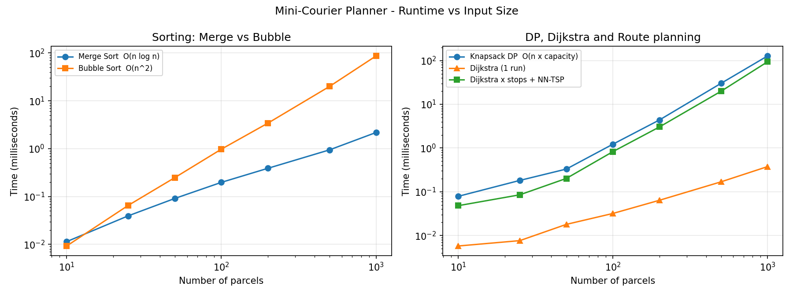

# Mini-Courier Planner
Submitted by: Naveen Singh, Roll No: 2501350063
**Course:** Design & Analysis of Algorithms (ETCCDA302), K.R. Mangalam University
**Language:** Python 3 (only `matplotlib` is needed, and only for the chart)

A prototype courier planner. Given parcels and a road map it (1) sorts parcels by urgency,
(2) chooses the best parcels for one van trip, (3) finds shortest roads and (4) builds a
delivery route that starts and ends at the warehouse. It also measures runtime as input grows.

---------------------------------------------------------------------

## How to run
```
pip install matplotlib      # only needed for the runtime chart
python courier_planner.py
```
Output goes to the terminal. Saved files: `results/runtime_chart.png`, `results/runtime_results.csv`.
`results/output_trace.txt` is a saved copy of one full run.

## Project files
| File | Purpose |
|---|---|
| `courier_planner.py` | All the code (all 5 algorithms + demo + performance test) |
| `data/sample_parcels.csv` | 12 sample parcels |
| `data/sample_graph.csv` | Road map: 10 nodes, 15 roads (node 0 = warehouse) |
| `results/` | Output trace, runtime chart, runtime table |

---------------------------------------------------------------------

## Phase 1 - Problem design

**Problem.** A van leaves the warehouse (node 0) with limited capacity. There are more parcels than the van
can carry. Choose which parcels to carry and in what order to visit their delivery points.

**Data design**

| Item | Format |
|---|---|
| Parcel | `id, destination node, weight_kg, priority (1-10), deadline_hr` (a Python dictionary) |
| Road map | Undirected weighted graph, **adjacency list**: `{node: [(neighbor, km), ...]}` |
| Van | capacity = 30 kg, average speed = 30 km/h (used only for deadline check) |

**How the algorithms fit together**
```
 parcels.csv ──► MERGE SORT ──► 0/1 KNAPSACK (DP) ──► chosen parcels ──► their delivery nodes
 (deadline,        (urgent first)   (max priority within                          │
  priority)                          van capacity)                                ▼
 graph.csv ───────────────────────────────────────────► DIJKSTRA from warehouse and every stop
                                                                                  │
                                                                                  ▼
                                                         NEAREST-NEIGHBOR TSP ──► final route + km
```

**Why these techniques**
- *Merge Sort* - guaranteed O(n log n); stable (equal items keep their order). Bubble Sort is implemented only for comparison.
- *0/1 Knapsack DP* - a parcel is either taken or left (cannot split a parcel), so 0/1 knapsack is the exact fit. Greedy can miss the best answer.
- *Dijkstra* - all road distances are positive, so Dijkstra gives exact shortest paths.
- *Nearest-Neighbor TSP* - the exact TSP is NP-hard (O(n!)); nearest-neighbor is a fast approximation.

---------------------------------------------------------------------

## Phase 2 - Package prioritization and box filling
1. **Merge Sort** orders parcels by `(deadline ascending, priority descending)`.
2. **0/1 Knapsack DP** builds `dp[i][c]` = best total priority using the first `i` parcels with capacity `c`:
   - skip parcel -> `dp[i-1][c]`
   - take parcel (if `weight <= c`) -> `dp[i-1][c-weight] + priority`
   - `dp[i][c]` = the larger of the two
3. Walk the table backwards to find which parcels were taken.

**Result on sample data:** parcels P03, P01, P10, P02, P05, P09 (30 kg, total priority 45).
The answer 45 was also verified by brute force over all 2^12 combinations.
The full DP table is printed in `results/output_trace.txt`.

## Phase 3 - Route maker and graph processing
1. Graph stored as an adjacency list (printed in the output).
2. **Dijkstra** (min-heap) gives the shortest distance and the actual road path to every node.
3. **Nearest-Neighbor TSP** works on *real road distances* from Dijkstra: from the current place go to the closest
   unvisited stop, repeat, then return to the warehouse.

**Result on sample data:** stop order `0 -> 1 -> 2 -> 5 -> 4 -> 3 -> 9 -> 0`, total **56 km**.
A deadline check (arrival time = distance / speed) shows all 6 parcels are on time.

## Phase 4 - Performance testing and optimization
Random datasets (fixed seed, so results can be repeated) from 10 to 1000 parcels. Best of 3 runs is recorded.
Correctness checks inside the test: both sorts give the same order, and the van is never overloaded.



| Parcels | Merge (ms) | Bubble (ms) | Knapsack (ms) | Dijkstra x stops + TSP (ms) |
|---:|---:|---:|---:|---:|
| 10 | 0.007 | 0.006 | 0.034 | 0.037 |
| 100 | 0.194 | 0.928 | 0.713 | 0.989 |
| 500 | 1.097 | 23.191 | 25.031 | 26.813 |
| 1000 | 2.477 | 97.738 | 94.928 | 117.455 |

(Times depend on the computer; the *growth pattern* is what matters. Full table in `results/runtime_results.csv`.)

**Observations**
- Bubble Sort grows about 100x when input grows 10x (O(n^2)); Merge Sort grows only slightly more than 10x (O(n log n)). At 1000 parcels Merge Sort is about 40x faster.
- Knapsack time grows quickly because the table has `n x capacity` cells (here capacity grows with n, so it behaves like n^2).
- A single Dijkstra run is cheap, but the route step runs it once per stop, so that cost adds up as the number of stops grows.

**Complexity summary**

| Component | Time | Space |
|---|---|---|
| Merge Sort | O(n log n) | O(n) |
| Bubble Sort | O(n^2) | O(n) copy |
| 0/1 Knapsack | O(n x W) | O(n x W) |
| Dijkstra (heap) | O((V+E) log V) | O(V) |
| Nearest-Neighbor TSP (k stops) | O(k^2) + k Dijkstra runs | O(k x V) |

**Suggested improvements**
1. Knapsack space can drop to O(W) with a 1-D array (but then the table cannot be printed or backtracked directly).
2. Compute Dijkstra only from stops that are needed, and cache results (already done per trip).
3. Improve the route with **2-opt** after nearest-neighbor to cut the route length.
4. Make the knapsack value depend on deadline urgency so that urgent parcels are favoured (right now it uses priority only).
5. Multiple vans / multiple trips for the parcels left behind.

## Phase 5 - Demonstration
Run `python courier_planner.py` and show: the sorted list, DP table, selected parcels, Dijkstra paths,
final route with km, deadline check, runtime table and chart. Add terminal screenshots to the submission.

## Limitations (honest notes)
- Nearest-neighbor is an approximation; it is not guaranteed to give the shortest possible route.
- The knapsack ignores deadlines when choosing parcels (it maximizes priority only); the deadline check afterwards only *reports* late parcels.
- One van, one trip, static map (no traffic).
